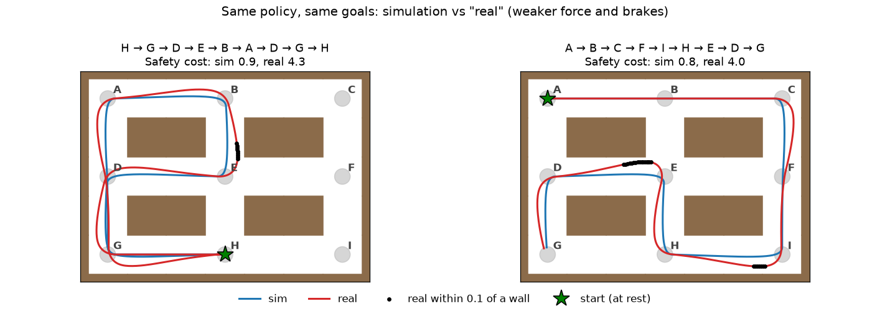

# safer-av: Terminal-State-Aware Long-Horizon Sim-to-Real Evaluation (toy study)

We estimate the **expected real-world cost of a fixed goal-conditioned policy over a sequence of goals**, from a limited
set of paired real and simulated segment transitions and a larger set of simulation-only segment transitions. Over
several goals the sim-to-real gap compounds: the robot ends each segment at a different observation in simulation and
in the real world, and that changes the cost of all remaining goals. **Backward Bellman calibration** learns a real
continuation value function from short to long goal sequences, using simulation targets corrected by a calibrator.

- Method: [METHODOLOGY.md](METHODOLOGY.md)
- Results page: `outputs/report/report.html` (a single file with embedded figures; download it and open it in a browser,
  since GitHub shows HTML files as source)
- Car version (a 1/10-scale car in the same maze; same method, costs and evaluation): [car/README.md](car/README.md)



The same policy drives the same goal sequence in simulation (blue) and in "real" (red). Real reaches the junctions
faster and swings wide into the outer wall in turns (black dots), so it ends each segment at a different observation
than the simulation, and that changes the cost of the following goals.

## Setting

| Item | Setting |
|---|---|
| Environment | PointMaze (MuJoCo ball) in a 9×7-cell maze with 9 local goals A–I at the junctions. A goal sequence moves between adjacent goals and never turns back |
| Observation x | 4 numbers: the ball's position and velocity (p_x, p_y, v_x, v_y). x and the goals are enough to predict what happens next (up to the actuation noise) |
| Policy | A PD controller that follows the shortest path to the current goal. When the ball reaches the goal (radius 0.2), the next goal starts; the ball keeps its velocity |
| Real vs. simulation | Sim2Sim. "Real" is the same simulator with weaker force (β = 0.85) and much weaker brakes (brake = 0.4). It reaches junctions faster and swings wide in turns |
| Paired real and simulated segment transitions | The real system drives random goal sequences (2–8 goals). At every goal boundary, the simulator is set to the recorded real observation and drives to the same goal. n = 200–1000 transitions, plus 50 for validation |
| Simulation-only segment transitions | One-segment simulations from two kinds of start observations. (1) 20,000 from random observations around the goals: random position near a goal with random velocity (60%), observations where a simulated segment ended (30%), or at rest on a goal (10%). (2) 4,000 from the real observations seen in the paired transitions (where a real segment started or ended), with small noise, so that the simulation data also cover where the real system actually goes |
| Evaluation queries | 536 goal sequences of K = 1, 2, 4, 8 goals, all starting at rest. Ground truth: mean of 100 real runs |
| Training | Same small MLP and the same training budget for every method. Input of `V_θ`: x and the remaining goals (up to 8 goal positions with a mask); the calibrator `h_φ` also gets `Z_S` |
| Repetitions | 3 data seeds × 3 model seeds = 9 runs for each n |

**Compared methods**

| Type | Name | What it does |
|---|---|---|
| baseline | Raw sim | simulated cost of the query, no correction |
| baseline | Segment-wise outcome correction | SCAPE-style: corrects the cost of each segment along the simulated run; ignores that the real run ends a segment at a different observation |
| baseline | Target-only | our backward learning, but with the real targets only (no simulation) |
| baseline | B1 MC-real | learns the real cost of whole goal sequences directly from the real runs |
| baseline | B2 route-level SCAPE | like B1, with the simulated cost of the sequence as an extra input |
| **ours (main)** | **Direct** | reads the learned real continuation value at the start: no simulation at evaluation time |
| ours | Sim-backed | runs the query in simulation and calibrates every simulated segment; equal to Direct in expectation |
| also tried | Residual direct | simulated cost of the query plus a learned real–simulation difference |

### How the method works

**Real continuation value function `V_θ(x; remaining goals)`.** It predicts the expected real cost of executing the
remaining goals from observation `x`. It is trained from one-goal sequences to longer ones, so the value of the shorter
remaining sequence is already available when the longer one is trained.

**Paired Bellman targets.** For a paired transition (real and simulated segment from the same observation, same goal):

- real target `Z_R = real cost + V_θ(real terminal observation; goals after this one)`
- simulated target `Z_S = simulated cost + V_θ(simulated terminal observation; goals after this one)`

Their difference is the cost difference of the current goal plus the effect of the different terminal observation on
the remaining goals.

**Calibrator `h_φ(x, remaining goals, Z_S) ≈ Z_R`.** It is trained on the paired transitions and applied to the
simulation-only transitions, giving calibrated targets `Z_cal`. `V_θ` is trained on the real targets of the paired
transitions and the calibrated targets of the simulation-only transitions.

**Two evaluation modes.**

- **Direct (main):** `J ≈ V_θ(x_1; g_1, …, g_K)`. No simulation is needed at evaluation time.
- **Sim-backed:** run the query in simulation (30 runs) and, for every simulated segment, add the calibrator's
  correction `Z_cal − Z_S` to the simulated cost. If the calibrator's average output at each simulated observation
  equals `V_θ` there, the terms cancel and its expectation is exactly the Direct estimate
  (METHODOLOGY, Section 3.3). It is reported for completeness; it showed no clear advantage over Direct.

**Residual direct (a variant we tried, not part of the method).** The real value is split into a simulated part,
computed by running the simulator along the remaining goals, and a learned real–simulation difference `D`. The
estimate is `simulated cost of the query + D(x_1; g_1, …, g_K)`. It needs multi-segment simulation from arbitrary
observations during training (METHODOLOGY, Section 4).

## Evaluation

Each method estimates the real cost of every evaluation query, separately for each of five costs. A segment cost is
computed from the trajectory of one segment (`safer_av/segment.py`); the cost of a query is the sum over its K segments.

| Cost | Per-segment definition | What it measures |
|---|---|---|
| Safety | max(0, 0.4 − minimum wall clearance) / 0.4 | the most dangerous moment of the segment (0.4 = corridor centre) |
| Exposure | ∫ max(0, 0.4 − wall clearance) / 0.4 dt | how deeply and how long the safety margin is intruded |
| TTC | max(0, 0.5 − minimum time to collision) / 0.5 | time until wall contact at the current velocity (ray cast) |
| Path | path length of the segment | wider turns are longer |
| Time | segment duration / 5 s | arrival time |

Path and Time add 5 when a segment does not reach its goal within 5 s.

Error metrics, computed over the queries of each length K ∈ {1, 2, 4, 8} against the real cost from 100 real
rollouts per query:

| Metric | Meaning |
|---|---|
| MAE | mean absolute error of the estimate (headline: K = 8) |
| Bias | mean signed error (estimate − truth) |
| RMSE | root mean squared error |
| Spearman | rank correlation between estimates and truth over queries (how well candidate routes are ranked) |

Every metric is reported per number of paired transitions n ∈ {200, 400, 600, 800, 1000} and averaged over the 9 runs
(3 data seeds × 3 model seeds).

## Results (K = 8)

K=8 MAE, mean over 9 runs (lower is better; best in bold). Means of every metric for every K and n are in
`outputs/report/summary.json`, per-run values in `outputs/results/`.

| Cost | n | Raw sim | Seg. outcome | Target-only | B1 | B2 | **Direct** | Sim-backed | Residual direct |
|---|---|---|---|---|---|---|---|---|---|
| Safety | 200 | 3.224 | 2.468 | 0.244 | 0.652 | 0.518 | 0.109 | **0.098** | 0.150 |
| Safety | 1000 | 3.224 | 2.578 | 0.110 | 0.530 | 0.400 | 0.059 | 0.067 | **0.057** |
| Exposure | 200 | 1.011 | 0.759 | 0.066 | 0.211 | 0.172 | 0.034 | **0.033** | 0.053 |
| Exposure | 1000 | 1.011 | 0.752 | 0.025 | 0.163 | 0.138 | **0.017** | 0.024 | 0.020 |
| TTC | 200 | 1.897 | 0.867 | 0.141 | 0.390 | 0.250 | **0.076** | 0.077 | 0.094 |
| TTC | 1000 | 1.897 | 0.919 | 0.080 | 0.247 | 0.172 | **0.038** | 0.055 | 0.041 |
| Path | 200 | 1.074 | 0.799 | 0.105 | 1.081 | 0.423 | 0.067 | 0.105 | **0.062** |
| Path | 1000 | 1.074 | 0.820 | 0.094 | 0.712 | 0.277 | 0.056 | 0.131 | **0.034** |
| Time | 200 | 0.035 | 0.013 | 0.007 | 0.044 | 0.029 | 0.005 | 0.006 | **0.004** |
| Time | 1000 | 0.035 | 0.018 | 0.008 | 0.031 | 0.017 | 0.005 | 0.009 | **0.003** |

- **Direct (main):** for K = 2, 4 and 8, it has a lower MAE than every baseline for all five costs and all five values
  of n.
- **Sim-backed:** lower than Direct in only 4 of the 25 cost × n cells at K = 8 (e.g. Safety and Exposure at n = 200)
  and higher in 21; on Path and Time it is also worse than target-only at larger n. Being equal to Direct in
  expectation, it adds simulation noise without a clear advantage.
- **Residual direct (tried):** the lowest of our three estimators on Safety, Path and Time for most n (on Path and Time
  the real–simulation difference is small compared with the cost itself); it needs extra multi-segment simulation
  during training.
- At K = 1, raw simulation is the most accurate for Safety, Exposure and Path: every query starts at rest, and a
  single segment from rest is almost the same in real and simulation, so no correction is needed.
- The 75% share of real targets in the training rows of `V_θ` was chosen by looking at test results (a small sweep).

## Running

**Install.** Python 3.11 and `pip install -r requirements.txt` (choose the torch build that matches your CUDA version).
A GPU is strongly recommended for step 3; CPU-only training works but is very slow.

**Included results.** The 45 per-run metric files (`outputs/results/res_*.json`) and the results page with its figures
(`outputs/report/`) are part of the repository, so the results can be read without running anything.

**Pipeline.**

| Step | Script | Output |
|---|---|---|
| 1 | `scripts/make_data.py` | `data/`: evaluation queries with ground truth, their simulation rollouts, simulation-only transitions (sim_train), paired transitions along real rollouts per data seed |
| 2 | `scripts/make_rows.py` | `data/`: simulation-only transitions near the real observations (seedR), Monte Carlo rows for the residual variant, B1/B2 windows |
| 3 | `scripts/run.py D N S` | `outputs/results/res_d{D}_n{N}_s{S}.json`: 8 methods × 5 costs, MAE / bias / RMSE / Spearman per K |
| 4 | `scripts/report.py` | `outputs/report/`: summary.json (means over the 9 runs), fig_mae_vs_n.png, report.html |
| – | `scripts/plot_env.py` | `outputs/report/fig_env.png`: the environment figure above |

**Quick check: one configuration** (data seed 0, n = 200, model seed 0). This regenerates only the data that run needs
and compares the result with the included file.

```bash
python scripts/make_data.py --workers 16
python scripts/make_rows.py --data-seeds 0 --sizes 200 --model-seeds 0 --workers 16
python scripts/run.py 0 200 0
git diff --stat outputs/results    # no output = the included numbers were reproduced exactly
```

**Full reproduction** (all 45 runs and the results page):

```bash
GPUS="0 1" JOBS=8 bash scripts/run_all.sh
```

`GPUS` lists the GPU ids used round-robin and `JOBS` the number of runs executed at the same time.

All random seeds are fixed. On the machine used for the reported results (x86-64, NVIDIA RTX PRO 6000 Blackwell,
CUDA 12.8), regenerating the data and rerunning all 45 runs reproduced every file and every metric exactly. Other
hardware or library versions can change the numbers slightly through floating-point differences.

## Terms and code

The code predates the current notation; the value function `V_θ` is called `W` in the code.

| Term (METHODOLOGY) | Code |
|---|---|
| evaluation query (x_1, g_1:K) | a test route: start observation and goal list (`queries_test.pkl`) |
| remaining goals g_k:K | `suffix`; without the current goal: `tail` |
| real continuation value function `V_θ` | `W` in `safer_av/ours.py` |
| calibrator `h_φ` | `h` in `safer_av/ours.py` |
| paired Bellman targets `Z_R`, `Z_S`; calibrated targets `Z_cal` | `ZR`, `ZS`; `ZRs` |
| segment cost, terminal observation | `y_<cost>`, `x_plus` in each transition record |
| paired transitions, simulation-only transitions | `d{D}/chain_train.pkl`; `sim_train.pkl` and the seedR rows |
| Direct, Sim-backed | `direct`, `sim_backed` (result keys `W_direct`, `W_simbacked`) |
| Residual direct: difference D, simulated value | `D`, `WS_S` / `WS_R` in `safer_av/residual.py` (result key `res_direct`) |

| File | Content |
|---|---|
| `safer_av/maze.py`, `policy.py`, `envs.py` | maze and goal graph, policy, real / simulation dynamics |
| `safer_av/segment.py`, `route.py` | one segment and its costs; a goal sequence executed without reset |
| `safer_av/data.py` | start-observation samplers, simulation-only transitions, ground truth of the queries, real rollouts |
| `safer_av/models.py` | input encoding, MLP regressor, training budget |
| `safer_av/backward.py` | remaining-goal sampling, target-only, segment-wise outcome correction |
| `safer_av/ours.py` | value function (`W` = `V_θ`) and calibrator `h`; Direct and Sim-backed |
| `safer_av/residual.py` | Residual direct (simulated value by running the simulator, learned D) |
| `safer_av/route_baselines.py` | B1, B2 |
