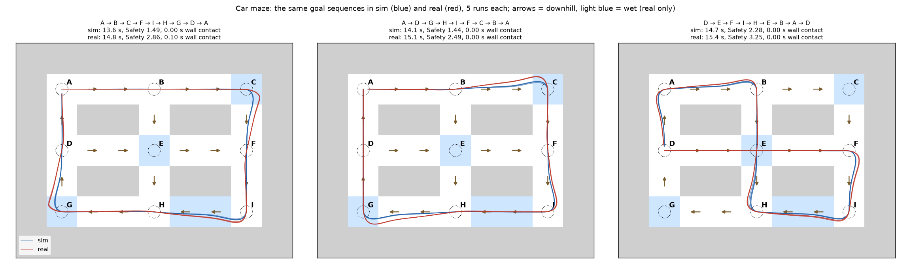
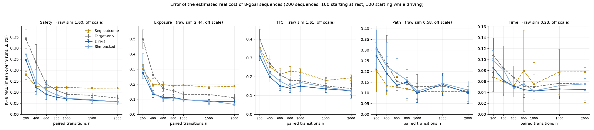

# Car maze: Terminal-State-Aware Long-Horizon Sim-to-Real Evaluation with a car

The PointMaze study ([../README.md](../README.md)) with a 1/10-scale car instead of a ball: the same maze layout, goals,
five costs, methods, data sizes and evaluation. We estimate the **expected real-world cost of a fixed goal-conditioned
controller over a sequence of goals** from a limited set of paired real and simulated segment transitions and a larger
set of simulation-only segment transitions. The method is described in [../METHODOLOGY.md](../METHODOLOGY.md).

- Results page: `outputs/report/report.html` (a single file with embedded figures; download it and open it in a
  browser, since GitHub shows HTML files as source)



The same controller drives the same goal sequences in simulation (blue) and in "real" (red), 5 runs each. Arrows: the
downhill direction of each corridor (the same in both). Light blue: wet cells (real only). Both cars reach a junction at
about the same speed, but in the turn the real car brakes less hard and has less grip, so it swings wide and starts the
next goal from a different state (`figs/routes_zoom_speed.png` zooms into two corners and shows the speeds).

## Setting

| Item | Setting |
|---|---|
| Environment | A 1/10-scale car in the same 9×7-cell maze (1 cell = 3 m, corridors 3 m wide) with 9 local goals A–I at the junctions. A goal sequence moves between adjacent goals and never turns back. Every corridor slopes 6° downhill in one direction, the same in sim and real (outer ring clockwise, middle row east, middle column south; a constant push in each corridor cell) |
| Car model | Dynamic bicycle model (the two front and the two rear wheels each lumped into one) with the F1TENTH car's mass, size and tyre stiffness; the tyre side force saturates at grip × load, so the car can skid. RK4 at 100 Hz, control at 20 Hz. A car touching a wall slides along it and loses 30% of its speed |
| Observation x | 7 numbers: position, heading, forward and sideways speed, yaw rate and steering angle (p_x, p_y, ψ, u, w, r, δ). x and the goals are enough to predict what happens next (up to the actuation noise). The networks get the heading as cos ψ and sin ψ (8 numbers) |
| Policy | A fixed rule-based controller that only knows the current goal. It steers toward a point a little ahead on the shortest path (pure pursuit), drives at 5 m/s on straights, and brakes before the goal and in sharp turns (speed² × path curvature ≤ 6 m/s²). When the car gets within 0.6 m of the goal, the next goal starts right away, without stopping |
| Real vs. simulation | Sim2Sim. "Real" is the same simulator with a weaker motor (4 vs 9.5 m/s²), weaker brakes (3.5 vs 7 m/s²), less tyre grip (0.8 vs 1.0) and 5 wet cells (grip 0.5) that the simulation does not have; the same actuation noise in both. The estimators never see or change these parameters |
| Paired real and simulated segment transitions | The real system drives random goal sequences (2–8 goals); half start at rest on a goal, half start moving near a goal (as if arriving from a neighbouring goal at 0–5 m/s). At every goal boundary, the simulator is set to the recorded real observation and drives to the same goal. n = 200–1000 transitions (as in the PointMaze study), extended to 1500 and 2000, plus 50 for validation |
| Simulation-only segment transitions | One-segment simulations from two kinds of start observations. (1) 20,000 segments cut from 2,500 simulated drives of 8 goals (each drive starts at rest; the other segments start where the previous one ended, i.e. while moving) (2) 4,000 from the real observations seen in the paired transitions (where a real segment started or ended), with small noise, each driving to a goal that is not behind the car |
| Evaluation queries | 936 goal sequences of K = 1, 2, 4, 8 goals: 536 start at rest on a goal (as in the PointMaze study) and 400 start while moving (the real state after 1–3 earlier goals). Ground truth: mean of 200 real runs |
| Training | The PointMaze study's small MLP (3 × 256) and training budget for every method. Input of `V_θ`: x and the remaining goals (up to 8 goal positions with a mask); the calibrator `h_φ` also gets `Z_S`. One network is shared by all remaining-goal lengths |
| Repetitions | 3 data seeds × 3 model seeds = 9 runs for each n |

**Compared methods**

| Type | Name | What it does |
|---|---|---|
| baseline | Raw sim | simulated cost of the query, no correction |
| baseline | Segment-wise outcome correction | SCAPE-style: corrects the cost of each segment along the simulated run; ignores that the real run ends a segment in a different state |
| baseline | Target-only | our backward learning, but with the real targets only (no simulation) |
| baseline | B1 MC-real | learns the real cost of whole goal sequences directly from the real runs |
| baseline | B2 route-level SCAPE | like B1, with the simulated cost of the sequence as an extra input |
| **ours (main)** | **Direct** | reads the learned real continuation value at the start: no simulation at evaluation time |
| ours | Sim-backed | runs the query in simulation and calibrates every simulated segment; equal to Direct in expectation |

**Setting checks.** Per-scene estimation needs costs that differ between scenes, a sim-to-real gap that changes from
scene to scene but stays related to the simulation, and segment costs that can be learned from (x, goal):

- The real cost of 8-goal sequences differs between sequences by 14–27% of its mean for Safety, Exposure and TTC (4–6%
  for Path and Time); driving the same 4 corridors in the opposite order changes Safety by 9%, Exposure by 11% and TTC
  by 39% (`scripts/check_scenes.py`).
- Real − sim over 8 goals: Safety +60%, Exposure +125%, TTC +189%, Path +3%, Time +8%; across sequences the real and
  simulated costs are correlated (0.45–0.98 depending on the cost; `outputs/report/fig_gap.png`).
- One segment: an MLP on (x, goal) explains 91–100% of the variance of the simulated segment costs
  (`scripts/check_learn.py`).

## Evaluation

The costs are the PointMaze study's, with distances in cells (1 cell = 3 m); the cost of a query is the sum over its K
segments (`carmaze/segment.py`).

| Cost | Per-segment definition | What it measures |
|---|---|---|
| Safety | max(0, 0.4 − minimum wall clearance) / 0.4 | the most dangerous moment of the segment (0.4 cell ≈ clearance at the corridor centre) |
| Exposure | ∫ max(0, 0.4 − wall clearance) / 0.4 dt | how deeply and how long the safety margin is intruded |
| TTC | max(0, 0.5 − minimum time to collision) / 0.5 | time until wall contact at the current velocity |
| Path | path length of the segment | wider turns are longer |
| Time | segment duration / 5 s | arrival time |

Path and Time add 5 when a segment does not reach its goal within 5 s (rare in this setting).

Error metrics (MAE, bias, RMSE, Spearman, as in the PointMaze study) are computed separately for the queries starting
at rest and the queries starting while moving, for each K ∈ {1, 2, 4, 8}, against the real cost from 200 real runs per
query; every metric is reported per number of paired transitions n ∈ {200, 400, 600, 800, 1000, 1500, 2000} and
averaged over the 9 runs.

## Results (K = 8)

K=8 MAE over the 200 sequences of 8 goals (100 starting at rest, 100 starting while moving), mean over 9 runs (lower
is better; best in bold). Separate tables per start type and every K: `outputs/report/report.html`; means of every
metric: `outputs/report/summary.json`; per-run values: `outputs/results/`.

| Cost | n | Raw sim | Seg. outcome | Target-only | B1 | B2 | **Direct** | Sim-backed |
|---|---|---|---|---|---|---|---|---|
| Safety | 200 | 1.604 | **0.179** | 0.341 | 0.810 | 0.336 | 0.245 | 0.271 |
| Safety | 1000 | 1.604 | 0.122 | 0.091 | 0.647 | 0.339 | **0.070** | 0.072 |
| Safety | 2000 | 1.604 | 0.119 | 0.073 | 0.520 | 0.279 | 0.057 | **0.056** |
| Exposure | 200 | 2.439 | 0.300 | 0.499 | 0.854 | 0.523 | **0.276** | 0.322 |
| Exposure | 1000 | 2.439 | 0.193 | 0.132 | 0.770 | 0.548 | 0.098 | **0.095** |
| Exposure | 2000 | 2.439 | 0.186 | 0.109 | 0.594 | 0.410 | 0.084 | **0.065** |
| TTC | 200 | 1.605 | 0.356 | 0.399 | 0.632 | 0.546 | **0.308** | 0.342 |
| TTC | 1000 | 1.605 | 0.224 | 0.178 | 0.589 | 0.553 | **0.149** | 0.169 |
| TTC | 2000 | 1.605 | 0.194 | 0.137 | 0.442 | 0.414 | **0.125** | **0.125** |
| Path | 200 | 0.579 | **0.203** | 0.309 | 1.218 | 0.673 | 0.273 | 0.304 |
| Path | 1000 | 0.579 | 0.106 | 0.128 | 0.669 | 0.321 | **0.099** | 0.108 |
| Path | 2000 | 0.579 | 0.105 | 0.106 | 0.538 | 0.246 | **0.100** | 0.113 |
| Time | 200 | 0.230 | **0.068** | 0.108 | 0.222 | 0.147 | 0.085 | 0.098 |
| Time | 1000 | 0.230 | 0.055 | 0.050 | 0.155 | 0.105 | **0.042** | 0.043 |
| Time | 2000 | 0.230 | 0.078 | 0.055 | 0.130 | 0.090 | **0.045** | 0.055 |



- **Direct (main):** lower K=8 error than every baseline on Exposure and TTC for every n (200–2000) and both start
  types (5–36% below the best baseline), and on Safety except at the smallest n.
- **Simulation data help:** against target-only (the same backward learning without simulation), Direct's error is
  21–48% lower on Safety, 21–50% on Exposure, 5–30% on TTC and 7–29% on Time; on Path it is between 9% higher and 24%
  lower.
- **Where sim and real differ little (Path +3%, Time +8%)** and the difference stays within each segment, correcting
  each segment's simulated outcome is often enough: segment-wise outcome correction is lower than Direct on Path at
  most n and on Time up to n = 400–600.
- **Segment-wise correction has a floor.** Real and sim end a segment in nearly the same state (0.07 m, 0.07 m/s,
  3.5° apart from the same start), but these small differences carry over to the later goals. Even an exact
  segment-wise correction (the true real cost of every segment along simulated runs; `scripts/check_terminal.py`)
  leaves a K=8 error of about 0.12 on Safety and 0.19 on Exposure; the learned one stays at this floor as n grows,
  while Direct keeps improving below it.
- **Sim-backed** is equal to Direct in expectation; its error is between 43% higher and 22% lower than Direct's.
- Raw simulation has 2–31× Direct's error; B1 and B2 1.3–9×. For the average cost over all sequences, every correction
  is within a few percent; the methods differ per scene.

**How accurate per scene.** True real cost of the 200 sequences of 8 goals and Direct's error:

| Cost | Real cost: mean ± std across sequences | Sim cost: mean | Error of one value for all sequences | Direct MAE, n = 1000 / 2000 | Direct R², n = 1000 / 2000 |
|---|---|---|---|---|---|
| Safety | 4.29 ± 0.81 | 2.69 | 0.639 | 0.070 / 0.057 | 0.99 / 0.99 |
| Exposure | 4.40 ± 0.78 | 1.96 | 0.614 | 0.098 / 0.084 | 0.97 / 0.98 |
| TTC | 2.45 ± 0.59 | 0.85 | 0.482 | 0.149 / 0.125 | 0.89 / 0.92 |
| Path (cells) | 21.09 ± 0.81 | 20.52 | 0.621 | 0.099 / 0.100 | 0.97 / 0.97 |
| Time (× 5 s) | 3.23 ± 0.17 | 3.00 | 0.131 | 0.042 / 0.045 | 0.88 / 0.80 |

R² is the share of the differences between sequences that the estimate explains (1: all, 0: no better than one value
for all sequences).

**Additional experiments**

- **Toy-style simulation-only data** (random starts near the goals instead of simulated drives; queries, true costs and
  paired data unchanged): the same conclusions (`outputs/report_simtoy/report.html`).
- **A separate network per remaining-goal length** (V_1…V_8 and h_1…h_8, and W_1…W_8 for target-only) instead of one
  shared network: about 1.5× slower to train; worse on Exposure at every n and on Safety from n = 400, better on TTC
  at most n and on Time up to n = 800, mixed on Path (`outputs/results_perlength/`, `scripts/run_perlength.py`). The
  shared network is used everywhere else.

## Running

Run everything from this folder (`car/`).

**Install.** The PointMaze study's environment (`../requirements.txt`); the car needs only numpy, torch and matplotlib.
A GPU is strongly recommended for the runs.

**Included results.** The per-run metric files (`outputs/results/res_*.json`: 7 n × 9 runs;
`outputs/results_simtoy/`, `outputs/results_perlength/`) and the results pages with their figures (`outputs/report/`,
`outputs/report_simtoy/`) are part of the repository.

**Pipeline.**

| Step | Script | Output |
|---|---|---|
| 1 | `scripts/make_data.py` | `data/`: evaluation queries with ground truth, their simulation rollouts, simulation-only transitions (sim_train), paired transitions along real rollouts per data seed (1000 each) |
| 2 | `scripts/make_rows.py` | `data/`: simulation-only transitions near the real observations (seedR), B1/B2 windows, for every n |
| 3 | `scripts/run.py D N S` | `outputs/results/res_d{D}_n{N}_s{S}.json`: 7 methods × 5 costs, MAE / bias / RMSE / Spearman per start type and K |
| 4 | `scripts/report.py` | `outputs/report/`: summary.json (means over the 9 runs), figures, report.html |
| n > 1000 | `scripts/extend_chains.py` | `data/`: 1000 more paired transitions per data seed (the first 1000 unchanged) |
| variant | `scripts/run_perlength.py D N S` | `outputs/results_perlength/`: a separate network per remaining-goal length |
| checks | `scripts/check_scenes.py`, `check_learn.py`, `check_terminal.py` | setting checks and the segment-wise floor |
| figures | `scripts/plot_routes.py`, `plot_zoom.py` | `figs/` |

**Reproduction.**

```bash
GPUS="0 1" JOBS=8 bash scripts/run_all.sh        # data, the 45 runs with n = 200-1000, results page
python scripts/extend_chains.py                    # paired data up to n = 2000
python scripts/make_rows.py --sizes 1500 2000
for d in 0 1 2; do for n in 1500 2000; do for s in 0 1 2; do python scripts/run.py $d $n $s; done; done; done
python scripts/report.py
```

Toy-style simulation-only data: `CARMAZE_SIM=toy CARMAZE_DATA=data_simtoy python scripts/make_data.py`, then
`make_rows.py` and the runs with the same `CARMAZE_DATA` and `CARMAZE_OUT=outputs/results_simtoy`, and `report.py`
with `CARMAZE_REPORT=outputs/report_simtoy`. Physics, controller and cost constants: `configs/*.json`. All random
seeds are fixed.

## Terms and code

As in the PointMaze code, the value function `V_θ` is called `W` in the code.

| Term (METHODOLOGY) | Code |
|---|---|
| evaluation query (x_1, g_1:K) | start state and goal list (`queries_test.pkl`; `tag` "moving" for the queries starting while moving) |
| remaining goals g_k:K | `suffix`; without the current goal: `tail` |
| real continuation value function `V_θ` | `W` in `carmaze/ours.py` |
| calibrator `h_φ` | `h` in `carmaze/ours.py` |
| paired Bellman targets `Z_R`, `Z_S`; calibrated targets `Z_cal` | `ZR`, `ZS`; `ZRs` |
| segment cost, terminal state | `y_<cost>`, `x_plus` in each transition record |
| paired transitions, simulation-only transitions | `d{D}/chain_train.pkl`; `sim_train.pkl` and `d{D}/seedR_n{N}.pkl` |
| Direct, Sim-backed | `direct`, `sim_backed` (result keys `V_direct`, `V_simbacked`) |

| File | Content |
|---|---|
| `carmaze/maze.py` | maze, goals and goal graph, slopes and wet cells |
| `carmaze/car.py` | car dynamics; simulation and real physics |
| `carmaze/policy.py` | the controller |
| `carmaze/segment.py` | one segment and its costs; a goal sequence executed without reset |
| `carmaze/data.py` | start states, simulation-only transitions, paired real rollouts, ground truth of the queries |
| `carmaze/models.py` | input encoding, MLP regressor, training budget |
| `carmaze/backward.py` | remaining-goal sampling, target-only, segment-wise outcome correction |
| `carmaze/ours.py` | value function (`W` = `V_θ`) and calibrator `h`; Direct and Sim-backed |
| `carmaze/route_baselines.py` | B1, B2 |
